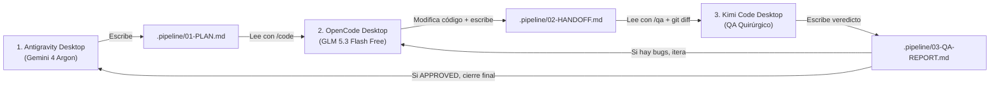

# Plan Opción A: 3 Ventanas Desktop + Buzón Compartido y Skills

## 1. Objetivo
Mantener el flujo visual que ya usas (tus **3 aplicaciones Desktop abiertas en la misma pantalla**, cada una ubicada en la carpeta del proyecto), pero **eliminando por completo el copiar/pegar de prompts largos** y reduciendo en un **70%–80% el gasto de cuota de Kimi Code**.

---

## 2. Arquitectura del "Buzón Compartido" (`.pipeline/`)

En lugar de pasar contexto por el portapapeles, los tres agentes se comunican leyendo y escribiendo en una carpeta estándar `.pipeline/` dentro del proyecto activo:

```text
tu-proyecto/
├── .pipeline/
│   ├── 01-PLAN.md        # Escrito por Antigravity (Argon): Contexto + pasos + criterios de aceptación
│   ├── 02-HANDOFF.md     # Escrito por OpenCode (GLM 5.3): Qué archivos tocó y qué tests corrió
│   └── 03-QA-REPORT.md   # Escrito por Kimi Code: Estado (APPROVED / CHANGES_REQUIRED) + hallazgos
```



---

## 3. Diseño de las Skills Compartidas

Tanto **Antigravity**, **OpenCode** como **Kimi Code** soportan el estándar de skills basadas en archivos `SKILL.md`. Se pueden instalar de forma global y enlazar simbólicamente (`ln -s`) para que los 3 agentes compartan las mismas definiciones.

### 3.1. Skill 1: `pipeline-plan` (Para Antigravity / Argon)
* **Disparador en el chat de Antigravity:** *"Arma el plan para [requerimiento] en el pipeline"*
* **Comportamiento:**
  1. Argon explora el repositorio a fondo (aprovechando su gran contexto).
  2. Identifica exactamente las rutas de archivos y líneas que deben crearse o modificarse (para que ni OpenCode ni Kimi gasten tokens buscando archivos).
  3. Genera `.pipeline/01-PLAN.md` con:
     * Objetivo y arquitectura.
     * Lista exacta de archivos a modificar/crear.
     * Pasos de implementación numerados.
     * Comandos de verificación/tests que OpenCode debe correr.
     * Checklist de QA para Kimi Code.

### 3.2. Skill 2: `pipeline-code` (Para OpenCode Desktop)
* **Disparador en el chat de OpenCode:** *"Ejecuta pipeline-code"* (o si hubo observaciones de QA: *"Corrige según pipeline-qa"*).
* **Comportamiento:**
  1. Lee `.pipeline/01-PLAN.md` (y `.pipeline/03-QA-REPORT.md` si existe).
  2. Implementa todos los cambios solicitados usando `GLM 5.3 Flash Free`.
  3. Ejecuta el linter, compilador o suite de tests hasta que pasen sin errores.
  4. Escribe `.pipeline/02-HANDOFF.md` resumiendo los archivos modificados y el resultado de los tests.

### 3.3. Skill 3: `pipeline-qa` (Para Kimi Code Desktop — Modo Ahorro de Cuota)
* **Disparador en el chat de Kimi Code:** *"Ejecuta pipeline-qa"*
* **Regla de Oro (Ahorro de tokens):** Tiene **estrictamente prohibido** usar herramientas de exploración masiva del repositorio (`find`, leer carpetas enteras).
* **Comportamiento:**
  1. Lee únicamente `.pipeline/01-PLAN.md` y `.pipeline/02-HANDOFF.md`.
  2. Ejecuta `git status -s` y `git diff` para ver exactamente las líneas modificadas por OpenCode.
  3. Evalúa bugs lógicos, condiciones de carrera, casos borde (edge cases), seguridad y cumplimiento del plan.
  4. Genera `.pipeline/03-QA-REPORT.md` comenzando con `STATUS: APPROVED` o `STATUS: CHANGES_REQUIRED`, listando archivo, línea y corrección exacta necesaria.

---

## 4. Plan de Implementación Paso a Paso

### Paso 1: Crear el directorio central de Skills
Crear las 3 skills en tu carpeta de configuración global y exponerlas a los tres agentes:
* **Antigravity:** `~/.gemini/config/skills/`
* **OpenCode:** `~/.config/opencode/skills/` (o `.agents/skills/`)
* **Kimi Code:** `~/.kimi/skills/` (o mediante `--skills-dir`)

### Paso 2: Añadir `.pipeline/` al `.gitignore` global
Configurar Git para que la carpeta `.pipeline/` no ensucie tus commits en ningún proyecto:
```bash
echo ".pipeline/" >> ~/.gitignore_global
git config --global core.excludesfile ~/.gitignore_global
```

### Paso 3: Rutina de Uso Diario (En tus 3 ventanas Desktop)
1. **Ventana 1 (Antigravity):** Escribes tu idea y pides generar el plan → crea `.pipeline/01-PLAN.md`.
2. **Ventana 2 (OpenCode):** Escribes `"Implementa el plan de .pipeline"` → programa todo y crea `.pipeline/02-HANDOFF.md`.
3. **Ventana 3 (Kimi Code):** Escribes `"Haz QA de .pipeline"` → audita solo el diff y crea `.pipeline/03-QA-REPORT.md`.
4. **Ventana 1 (Antigravity):** Le dices `"Revisa el cierre de .pipeline"` → Argon lee el reporte de Kimi y te confirma que todo quedó listo.

---

## 5. Ventajas y Limitaciones
* **Ventajas:** Cero infraestructura nueva, mantienes el control visual total en tus 3 apps oficiales de Mac, y ahorras el máximo posible de cuota en Kimi Code.
* **Limitaciones:** Sigues teniendo que cambiar de ventana con `Cmd+Tab` y escribir un comando corto de 2-3 palabras para disparar cada fase.

---

*Firmado por: **Antigravity (Gemini 4 Argon)** — Cerebro & Arquitecto Principal*
