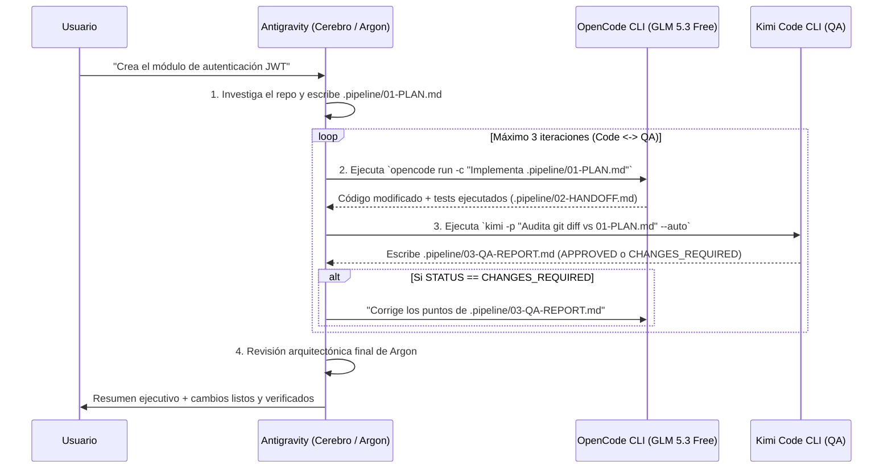

# Plan Opción B: Antigravity como Orquestador 100% Automático (Vía CLI Headless)

## 1. Objetivo
Lograr que **tú solo interactúes con una ventana (Antigravity con Gemini 4 Argon)** y que Antigravity actúe como el "Director de Orquesta" automático: él elabora el plan, llama por terminal en segundo plano a **OpenCode (`GLM 5.3 Flash Free`)** para que escriba el código, luego invoca a **Kimi Code** para que haga el QA, e itera automáticamente entre OpenCode y Kimi hasta que el código quede aprobado.

---

## 2. Cómo Funciona Bajo el Capó

En tu Mac ya cuentas con los binarios CLI de ambos agentes secundarios, los cuales soportan ejecución **no interactiva (headless)** y **persistencia de sesión por carpeta de proyecto** (`-c` / `--continue`):

1. **OpenCode CLI:**
   * Ruta: `~/.opencode/bin/opencode`
   * Comando no interactivo:
     ```bash
     ~/.opencode/bin/opencode run -c "Prompt de tarea"
     ```
2. **Kimi Code CLI:**
   * Ruta: `~/.kimi-code/bin/kimi`
   * Comando no interactivo autónomo:
     ```bash
     ~/.kimi-code/bin/kimi -p "Prompt de QA" --auto -c
     ```

> [!TIP]
> **Persistencia compartida con tus Apps Desktop:** Al usar el flag `-c` (`--continue`) dentro de la carpeta del proyecto, las sesiones que Antigravity dispare por debajo quedan guardadas en el historial local de ese proyecto. Si abres OpenCode Desktop o el visualizador de Kimi (`kimi vis` / `kimi web`), ¡podrás ver todo lo que hicieron!

---

## 3. Flujo de Ejecución Autónoma



---

## 4. Diseño del Script Orquestador y la Skill de Antigravity

### 4.1. Script Puente: `~/.local/bin/agent-pipeline`
Un script ejecutable en Bash/Node que Antigravity puede invocar (o que tú puedes correr manualmente) con tres subcomandos:
* `agent-pipeline code [project_dir]` → Llama a `opencode run` pasándole la instrucción de implementar `.pipeline/01-PLAN.md` (y corregir `.pipeline/03-QA-REPORT.md` si existe).
* `agent-pipeline qa [project_dir]` → Extrae únicamente el `git diff` y el `01-PLAN.md` y llama a `kimi -p ... --auto`, asegurando que Kimi **nunca** gaste tokens explorando archivos fuera del diff.
* `agent-pipeline loop [project_dir] --max-retries 3` → Ejecuta automáticamente `code` → `qa` → si `03-QA-REPORT.md` contiene `STATUS: CHANGES_REQUIRED`, vuelve a correr `code` hasta obtener `STATUS: APPROVED`.

### 4.2. Skill en Antigravity: `orquestador-equipo`
Ubicada en `~/.gemini/config/skills/orquestador-equipo/SKILL.md`.
* **Instrucciones para Argon:**
  1. Cuando el usuario pida desarrollar una funcionalidad usando el equipo multi-agente:
  2. Analizar el repositorio y escribir `.pipeline/01-PLAN.md`.
  3. Ejecutar mediante `run_command` el script `agent-pipeline loop . --max-retries 3`.
  4. Al terminar el bucle, leer `.pipeline/03-QA-REPORT.md` y el `git diff` final para darle el visto bueno arquitectónico al usuario.

---

## 5. Plan de Implementación Paso a Paso

1. **Fase 1 (Preparación de Plantillas):** Definir el formato estricto de `.pipeline/01-PLAN.md`, `02-HANDOFF.md` y `03-QA-REPORT.md` (compartido con la Opción A).
2. **Fase 2 (Script CLI `agent-pipeline`):** Crear el script en `~/.local/bin/agent-pipeline` con manejo de timeouts, logs en `.pipeline/logs/` y detección automática de `STATUS: APPROVED`.
3. **Fase 3 (Skill `orquestador-equipo`):** Registrar la skill global en Antigravity para que cualquier proyecto que abras en Antigravity tenga disponible este flujo automático.
4. **Fase 4 (Prueba Piloto):** Ejecutar una tarea pequeña en un repositorio de prueba y verificar cuántos tokens consumió Kimi Code y cómo iteró OpenCode.

---

## 6. Ventajas y Limitaciones
* **Ventajas:** Automatización real de principio a fin ("Zero Copy-Paste, Zero Window Switching"). Te permite delegar tareas medianas/grandes y recibir el código ya auditado por Kimi y revisado por Argon.
* **Limitaciones:** Mientras OpenCode o Kimi están trabajando por CLI en segundo plano, verás su progreso en los logs de la tarea de Antigravity en lugar de ver el texto escribirse letra por letra en tres ventanas separadas (a menos que abras la Opción C).

---

*Firmado por: **Antigravity (Gemini 4 Argon)** — Cerebro & Arquitecto Principal*
