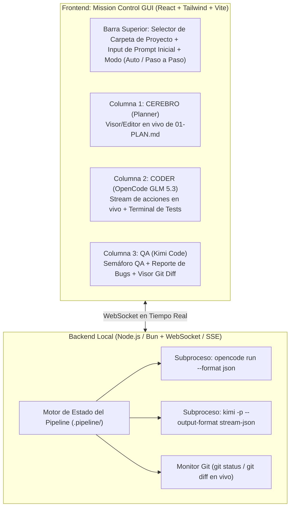

# Plan Opción C: Interfaz Gráfica Propia (GUI "Mission Control")

## 1. Objetivo
Construir tu propia aplicación visual en `/Volumes/JeanFiles/code/Jean/multi-agent` que funcione como un **"Mission Control" de 3 columnas en una sola pantalla**. En ella seleccionas la carpeta de cualquier proyecto tuyo, escribes el prompt de lo que necesitas, y ves en vivo cómo **el Cerebro planea**, **OpenCode programa** y **Kimi Code audita**, con control visual del `git diff` y botones para intervenir si lo deseas.

---

## 2. Por qué es 100% Viable con tus Herramientas Actuales

Tanto `opencode` como `kimi` fueron diseñados con modos especiales para ser controlados por interfaces gráficas externas:

1. **Modo Streaming JSON por CLI:**
   * **OpenCode:** `/Volumes/JeanFiles/.opencode/bin/opencode run --format json -c "prompt"`
   * **Kimi Code:** `/Volumes/JeanFiles/.kimi-code/bin/kimi -p "prompt" --auto -c --output-format stream-json`
   * Ambos emiten eventos JSON línea por línea (pensamiento en vivo, qué herramienta están ejecutando, qué archivo están editando y respuesta final).
2. **Modo ACP (Agent Client Protocol):**
   * Ambos binarios tienen el subcomando `acp` (`opencode acp` y `kimi acp`), que levanta un servidor JSON-RPC estándar por `stdio` para que una interfaz gráfica mantenga una sesión bidireccional viva.

---

## 3. Arquitectura de la Aplicación (`multi-agent`)

---

## 4. Diseño de la Interfaz Visual (Las 3 Ventanas en 1)

### 4.1. Cabecera de Proyecto y Control
* **Selector de Proyecto:** Un desplegable con tus repositorios recientes en `/Volumes/JeanFiles/code/` (ej. elegir cualquier proyecto en el que estés trabajando).
* **Modo de Ejecución:**
  * **Semi-Automático (Con pausa de aprobación):** Genera el plan y espera que le des clic a *"Aprobar Plan y Mandar a OpenCode"*.
  * **Full Piloto Automático:** Pasa de Plan → OpenCode → Kimi QA → Corrección en OpenCode automáticamente hasta que el semáforo de QA se ponga en Verde.

### 4.2. Los 3 Paneles en Paralelo (Vista Kanban / Split-Screen)
1. **Panel Izquierdo — El Cerebro (Planificación):**
   * Muestra el archivo `.pipeline/01-PLAN.md` renderizado en Markdown (y editable por si quieres ajustar un detalle antes de que OpenCode empiece).
   * Puede ser generado por Antigravity (Argon) o disparado desde la misma UI.
2. **Panel Central — El Obrero (OpenCode - GLM 5.3 Flash Free):**
   * Muestra en tiempo real qué archivos está leyendo/editando OpenCode y qué comandos de terminal está corriendo.
   * Contador de iteración actual (ej. `Iteración 1/3`).
3. **Panel Derecho — El Auditor (Kimi Code QA):**
   * Muestra un badge de estado: `EN ESPERA`, `AUDITANDO DIFF`, `CHANGES REQUIRED (Rojo)` o `APPROVED (Verde)`.
   * Muestra el gasto estimado de contexto (para que veas qué tan poquito consumió al enviarle solo el `git diff`).
   * Lista interactiva de observaciones que, si hay errores, se reenvían automáticamente al Panel Central (OpenCode).

### 4.3. Cajón Inferior: Visor de `Git Diff` Unificado
* Un panel desplegable abajo donde puedes ver exactamente todos los cambios hechos en el repositorio antes de hacer commit.

---

## 5. Stack Tecnológico Recomendado (Ligero y Rápido)

* **Backend + Frontend unificado:** **Node.js (o Bun) + Express/Fastify + WebSockets (`ws`)** en el backend, y **React + Vite + TailwindCSS** en el frontend (o empaquetado como ventana nativa de Mac con **Tauri** / **Electron** si prefieres un ícono en tu Dock).
* **Almacenamiento:** Basado en archivos dentro de `.pipeline/` del proyecto seleccionado + un SQLite ligero local para guardar el historial de ejecuciones.

---

## 6. Plan de Construcción por Fases (En `/Volumes/JeanFiles/code/Jean/multi-agent`)

* **Fase 1 — Backend Orquestador y Parser de Streams (Día 1):**
  * Crear el servidor local que recibe la ruta de un proyecto, gestiona `.pipeline/` y lanza `opencode` y `kimi` en modo `stream-json`, retransmitiendo los eventos por WebSocket.
* **Fase 2 — Interfaz de 3 Columnas en Tiempo Real (Día 1-2):**
  * Construir la vista con las 3 columnas en vivo, el selector de proyecto y los botones de *"Mandar a OpenCode"*, *"Pasar a Kimi QA"* y *"Piloto Automático"*.
* **Fase 3 — Visor de Git Diff y Conector con Antigravity (Día 2):**
  * Agregar el visor de `git diff` integrado y un File Watcher (`chokidar`) sobre `.pipeline/01-PLAN.md`: así, apenas Antigravity (Argon) guarde el plan desde esta ventana, tu GUI lo detecta al instante y arranca la tubería sola.
